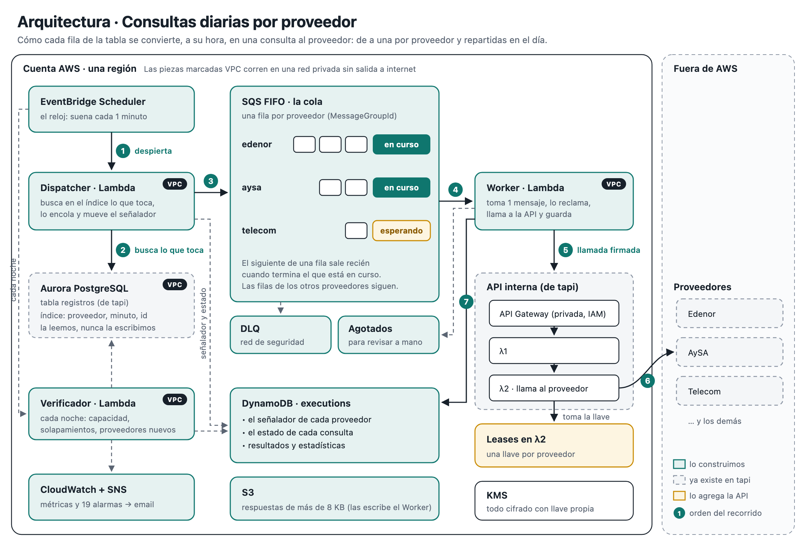

# Consultas diarias por proveedor

Propuesta de arquitectura e implementación para el desafío técnico de tapi.



Cada registro `(id, proveedor, endpoint, body)` se consulta una vez por día contra la API interna. Cada uno tiene un minuto fijo del día, que sale de un hash de su id, así las consultas se reparten parejas en las 24 h. Nunca hay dos llamadas simultáneas al mismo proveedor: la exclusión la impone SQS FIFO (un grupo por proveedor) y la refuerza un lease dentro de λ2.

## Cómo leer esta entrega

| Criterio del enunciado | Dónde está |
|---|---|
| Diagrama de arquitectura | El diagrama de arriba y la [§2 Arquitectura](docs/ARQUITECTURA.md#2-arquitectura), con la responsabilidad de cada componente |
| Justificación de las decisiones | El [Resumen](docs/ARQUITECTURA.md#resumen), las §4 a §6 y los anexos [B (alternativas evaluadas)](docs/ARQUITECTURA.md#anexo-b--alternativas-evaluadas) y [C (decisiones)](docs/ARQUITECTURA.md#anexo-c--decisiones-adrs) |
| Ciclo de vida de desarrollo | La [§9](docs/ARQUITECTURA.md#9-ciclo-de-vida-de-desarrollo) y el CI de este repo (`.github/workflows/ci.yml`) |
| Plan de desarrollo | La [§10](docs/ARQUITECTURA.md#10-plan-de-desarrollo) |

El código no lo pide el enunciado: es un prototipo que valida el diseño, sobre todo la exclusión por proveedor. Para entender la propuesta alcanza con [docs/ARQUITECTURA.md](docs/ARQUITECTURA.md).

## Estructura

```
docs/ARQUITECTURA.md     propuesta: diagramas, decisiones, ciclo de vida y plan
src/
  domain/                lógica pura y testeable: slots, cursor, clasificación de errores,
                         backoff, admisión, breakers, allowlist (SSRF), SLI de solapamiento
  handlers/              Dispatcher, Worker y Verificador, con dependencias inyectadas
  adapters/              DynamoDB, Postgres (Aurora), SQS, S3 y cliente HTTP firmado (SigV4)
  entrypoints/           conexión de los handlers con los adaptadores reales (una por Lambda)
  api-lease/             lease por proveedor para λ2: lo que se le entrega al equipo de la API
infra/                   AWS CDK: colas, tabla, Lambdas, Scheduler, KMS, IAM y alarmas
sql/                     índice del slot y usuario de solo lectura
tests/                   unitarios, handlers con fakes en memoria, infraestructura (cdk-nag)
                         e integración contra emuladores (tests/integration)
local/                   entorno local: emuladores en Docker, API mock y simulación de punta a punta
.github/                 CI y Dependabot
```

## Cómo correrlo

Requisitos: Node 22.12 o superior.

```bash
npm ci                # instala exactamente lo del lockfile
npm run typecheck
npm test              # 125 tests: dominio, handlers, lease e infraestructura (sin Docker)
npm run synth         # CloudFormation + cdk-nag; un hallazgo sin justificar rompe el build
npm run check         # typecheck + tests + auditoría de dependencias
```

Para regenerar el lockfile desde cero hace falta npm 11 (`npx npm@11 install`): npm 10.9 tiene un bug con los peers opcionales de vitest 4.

## Entorno local (sin cuenta de AWS)

El código real (Dispatcher, Worker y adaptadores) corre contra emuladores en Docker:

| Servicio | Emulador | Qué se prueba de verdad |
|---|---|---|
| Aurora PostgreSQL | Postgres 17 | La tabla `registros`, el índice del slot, la query `LATERAL` y el body como texto |
| DynamoDB | DynamoDB Local (AWS) | Las escrituras condicionales: claim, fencing con token, cursor, ledger |
| SQS FIFO | ElasticMQ | Grupos de mensajes, retención con `ChangeMessageVisibility`, deduplicación |
| API interna | `local/mock-api.ts` (HTTPS) | Proveedores con distinta latencia, uno inestable, una ruta inexistente y el **detector de concurrencia** |

```bash
brew install colima docker docker-compose   # una sola vez: local:up y local:down usan colima
npm run local:up            # levanta los emuladores y genera el certificado de la API mock
npm run local:setup         # crea tabla, colas y proveedores (idempotente)
npm run test:integration    # 12 tests contra los emuladores
npm run local:simular       # simulación de punta a punta (~4 min) con verificaciones
npm run local:down          # baja todo (y `colima stop` para apagar la VM)
```

Con Docker Desktop, en lugar de `npm run local:up` se corre `docker compose -f local/docker-compose.yml up -d --wait` y `bash local/generar-cert.sh`, que es lo que hace el CI. El resto de los comandos es igual.

La simulación adelanta el reloj hasta las 23:55 UTC y despacha el día completo, unos 5.000 registros, con los handlers reales. Los pollers emulan el event source mapping de Lambda. Al final hace 9 verificaciones:

1. Nunca hubo dos llamadas simultáneas al mismo proveedor.
2. Todas las llamadas salieron firmadas con SigV4.
3. El body llegó intacto (un entero de 20 dígitos sin redondear).
4. El registro envenenado no pausó el sistema.
5. El registro envenenado agotó sus intentos y fue a la cola de agotados.
6. El intento de SSRF se rechazó sin llamar a la API.
7. Ningún mensaje cayó a la DLQ de seguridad.
8. No hubo errores no controlados en el worker.
9. Se completaron consultas en los 5 proveedores.

Resultado (corre en cada push en el CI):

- **~4.100–4.200 llamadas** a la API; varía entre corridas por los errores aleatorios del proveedor inestable.
- **Máximo en vuelo por proveedor: 1, con 0 solapamientos.**
- **Las 9 verificaciones en verde.**

**Lo que el entorno local no reemplaza.**

- ElasticMQ emula SQS, pero la confirmación definitiva de que Lambda con FIFO retiene el grupo igual que acá es el PoC en AWS (semana 1 del plan).
- La simulación no genera timeouts: la cuarentena tras un resultado desconocido se prueba en los tests del Worker.
- Tampoco se prueban IAM, KMS ni la VPC.

**Hallazgo de la simulación.** El proveedor `inestable` (15% de caídas y 5% de errores de registro) procesó ~125 consultas en 4 minutos, contra ~1.000 de cada uno de los demás. Es lo esperado: los reintentos ocurren dentro de su grupo y frenan solo a ese proveedor, nunca a los otros. Pero con datos reales en ese nivel conviene activar el reintento diferido (Anexo A).

### Configuración

Los valores de `cdk.json` son de ejemplo. Los reales van en `cdk.context.json` (ignorado por git) o por `-c clave=valor`:

| Clave | Para qué |
|---|---|
| `stage`, `workerMaxConcurrency` | Entorno (`dev`, `staging` o `prod`) y máximo de Workers en paralelo (20 por defecto) |
| `vpcId`, `privateSubnetIds`, `availabilityZones`, `vpcCidr` | VPC existente, sin salida a internet |
| `endpointsSecurityGroupId`, `gatewayPrefixListIds` | Acotan el egress 443 a los VPC endpoints. Si faltan, el synth avisa |
| `dbHost`, `dbPort`, `dbName`, `dbUser`, `dbResourceId`, `dbSecurityGroupId`, `manageDbIngress` | Reader de Aurora con autenticación IAM (ver `sql/002_usuario_lectura.sql`). Con `manageDbIngress`, el stack abre el 5432 en el security group de la base |
| `apiId`, `apiStage`, `apiPathPrefixes` | API interna privada y rutas que el worker puede invocar |
| `leaseInApi`, `leasesTableName` | Si λ2 ya tiene el lease; si no, el worker aplica la cuarentena |
| `operatorRoleArns` | Roles que pueden leer la DLQ y la cola de agotados |
| `alarmEmail` | Obligatorio fuera de `dev` |

Antes del primer despliegue, el dueño de la base corre `sql/001_indice_slot.sql` y `sql/002_usuario_lectura.sql`.

## Seguridad

La seguridad se revisó en tres frentes: aplicación, supply chain e infraestructura. Lo de severidad alta y media está corregido y tiene un test que lo cubre:

| Área | Control |
|---|---|
| SSRF | Allowlist por proveedor validada por segmento: sin `%`, `+`, `;`, `@`, `//` ni segmentos de puntos. Además, IAM limita `execute-api:Invoke` a las mismas rutas |
| Registro envenenado | Una falla que no viene del proveedor solo pausa el sistema si afecta a varios registros de al menos dos proveedores. Si no, el registro agota sus intentos |
| Inyección de trabajos | Políticas de recurso: solo el Dispatcher encola y solo el Worker consume |
| Exclusión | FIFO por proveedor, lease en λ2, fencing del claim con token y una sola capa de reintentos |
| IAM | Roles propios sin políticas administradas, KMS con `kms:ViaService` y un Deny para que el código no use los permisos de ENI |
| Datos | KMS en colas, tabla, bucket y tópico; los logs solo tienen ids y códigos; usuario de base de solo lectura |
| Supply chain | `npm audit` sin vulnerabilidades (runtime y dev), lockfile, Actions fijadas por SHA, gitleaks, SBOM y Dependabot |

## Pendiente antes de producción

- **PoC en una cuenta real.** Validar que `ChangeMessageVisibility` combinado con `batchItemFailures` retiene el grupo FIFO como se espera, y medir el tiempo de ocupación por grupo. Ver la semana 1 del plan.
- **Equipo de la API.** Integrar en λ2 el lease (la implementación de referencia está en `src/api-lease`), el header `x-error-origin` y el almacén de idempotencia.
- **Operación.**
  - Herramienta de redrive desde la cola de agotados, con una nueva generación de intentos.
  - Reglas de EventBridge sobre CloudTrail: cambios de la clave KMS, de las políticas y de los security groups.
  - Separación de administradores y usuarios de la clave KMS en prod.
- **Pipeline de despliegue.** OIDC hacia AWS y entornos con aprobación.
