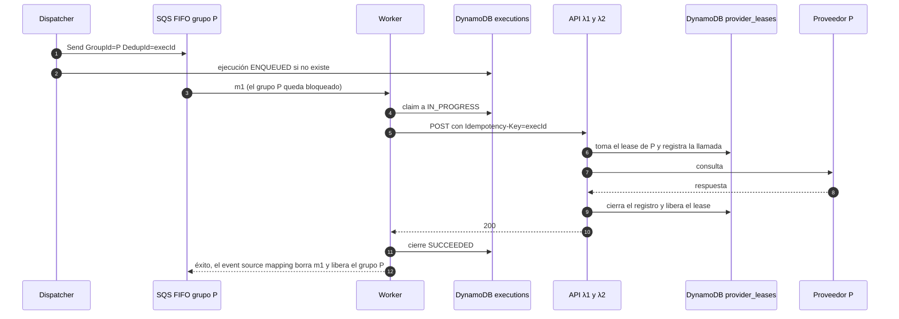
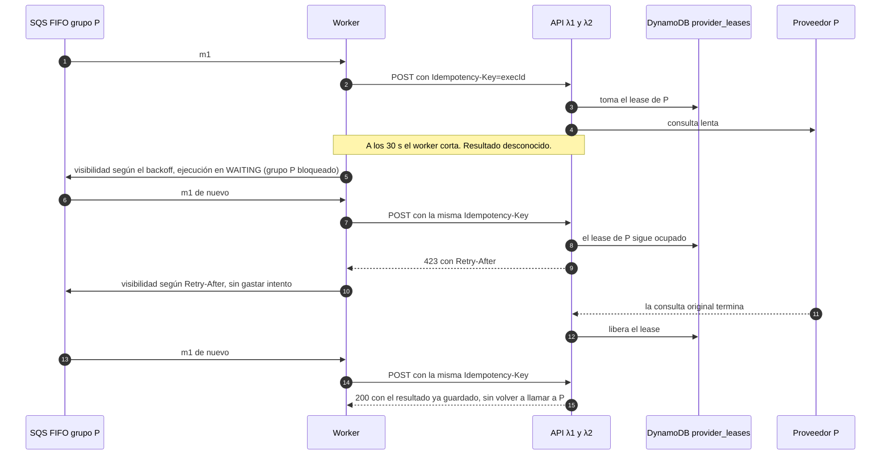
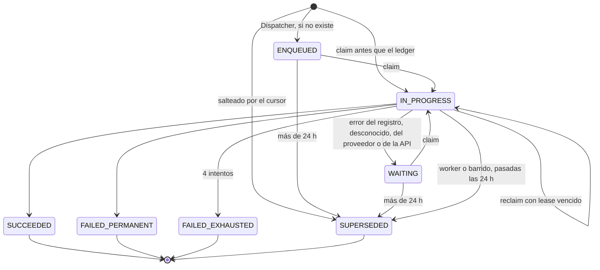

# Consultas diarias por proveedor

Propuesta de arquitectura · Desafío técnico tapi · Octubre 2026

---

## Resumen

**Problema.** Cada registro de `registros(id, proveedor, endpoint, body)` es una consulta diaria a una API interna (API Gateway → λ1 → λ2 → proveedor externo). Hoy son 1M de registros y la tabla puede crecer N veces. Las consultas tienen que:

- repartirse a lo largo del día;
- guardar su resultado;
- distinguir errores reintentables de no reintentables;
- no hacer nunca dos llamadas simultáneas al mismo proveedor.

**Propuesta.**

- Un reloj reparte los registros en los 1.440 minutos del día.
- Una cola **SQS FIFO** tiene un grupo de mensajes por proveedor. SQS no entrega el siguiente mensaje de un grupo hasta que se resolvió el anterior, así que **la exclusión entre nuestros workers la impone el servicio**, no nuestro código. Se mantiene ante crashes, deploys y reintentos.
- **Un lease dentro de λ2** extiende esa exclusión hasta el punto donde se llama al proveedor.
- El camino de datos usa 5 servicios (EventBridge Scheduler, Dispatcher, SQS FIFO, Worker y DynamoDB), con un verificador diario al costado.

**Los tres problemas difíciles.**

| Problema | Por qué es difícil | Solución |
|---|---|---|
| La cadena λ1→λ2 sigue viva cuando el worker corta por timeout | Un reintento inmediato llamaría al proveedor mientras λ2 todavía lo llama | Lease por proveedor en λ2 y una sola capa de reintentos. Si la API no se puede cambiar, cuarentena de 90 s |
| SQS FIFO solo revisa los primeros 120.000 mensajes para encontrar grupos libres | El backlog de un proveedor lento bloquearía a todos | Admisión por proveedor con una cota global de 60.000 mensajes por cola |
| Con exclusión, un proveedor atiende como máximo 86.400 s ÷ tiempo de ciclo consultas por día | Un proveedor grande puede no entrar en 24 h | Modelo de capacidad ρ, medido y con alerta preventiva |

**Semántica de entrega.**

- La entrega es at-least-once. Con el claim condicional y la `Idempotency-Key` queda **un único resultado registrado por (registro, día)**.
- Con el lease en λ2, nunca hay dos llamadas nuestras en vuelo hacia un mismo proveedor. Con la cuarentena, que es la alternativa si la API no cambia, la garantía es temporal: depende de que se respeten los timeouts y el init de Lambda (cota de 72 s).
- Un duplicado hacia el proveedor solo puede ocurrir ante fallas, y es inocuo si la consulta es de solo lectura, como sugiere el enunciado.

**Números.**

- 1M de registros por día son 11,6 req/s, con ~12 requests en vuelo.
- Costo: ~USD 580/mes, unos USD 19 por millón de consultas.
- Plazos: MVP en 4 semanas, producción en 7.

**Decisiones clave** (detalle en el [Anexo C](#anexo-c--decisiones-adrs)):

1. **Exclusión con SQS FIFO**, con `MessageGroupId = proveedor`. Entre las opciones donde la garantía la da un servicio, es la única serverless que además aísla a cada proveedor: un reintento solo bloquea a su propio grupo.
2. **El minuto del día sale de un hash estable del id** (`md5`) en un índice sobre la tabla existente. No hace falta agregar columnas ni hacer backfill.
3. **Un cursor por proveedor en el Dispatcher** resuelve la admisión, la recuperación de minutos perdidos y el descarte de lo vencido.
4. **Lease en λ2** como segunda capa de exclusión, puesta en el recurso.
5. **Núcleo mínimo con una ruta de evolución activada por métricas** ([Anexo A](#anexo-a--ruta-de-evolución)).

---

## 1. Supuestos e interpretación

| # | Supuesto o interpretación | Si no se cumple |
|---|---|---|
| S1 | La base origen es PostgreSQL (Aurora o RDS) con un reader, y la tabla es `registros(id, proveedor, endpoint, body)`, como en el enunciado | Con DynamoDB, un GSI sobre `proveedor` + `slot`. Con otro motor, una columna calculada e indexada |
| S2 | "Evitar concurrencia" significa como máximo 1 request nuestro en vuelo por proveedor | Si alcanza con un rate limit, la admisión lo cubre. Si un proveedor acepta `c > 1`, ver el Anexo A |
| S3 | "Diaria" significa una ejecución por registro y por día UTC | Un día de negocio local solo desplaza el origen. UTC evita el cambio de horario |
| S4 | λ2 es la que llama al proveedor externo | Si fuera λ1, el lease va en λ1 |
| S5 | La consulta es de solo lectura en el proveedor | Si escribe, la `Idempotency-Key` pasa a ser obligatoria del lado de la API |
| S6 | Un alta se consulta en su próximo turno: el mismo día si su minuto todavía no pasó y, si no, al día siguiente. Las bajas se borran | Si hay un flag de baja, se agrega al índice parcial. Si las altas deben correr al instante: outbox + CDC (Anexo A) |

---

## 2. Arquitectura


Fuente editable: [diagramas/arquitectura.svg](diagramas/arquitectura.svg). El diagrama de abajo es el mismo en Mermaid, con el detalle de los permisos y las colas.

```mermaid
flowchart LR
  subgraph AWS["Cuenta AWS · una región · datos cifrados con KMS"]
    SCH["EventBridge Scheduler"]
    subgraph VPC["VPC privada sin internet · endpoints de interfaz SQS y execute-api · gateway DynamoDB y S3"]
      DISP["① Dispatcher λ<br/>cada 1 min · reserved concurrency 1"]
      WRK["③ Worker λ<br/>batch 1 · MaximumConcurrency N"]
      VER["Verificador λ<br/>diario · ρ y SLI"]
      RDB[("Aurora reader<br/>índice proveedor, slot, id")]
    end
    DDB[("DynamoDB executions<br/>cursores · ledger · resultados")]
    S3[("S3<br/>respuestas mayores a 8 KB")]
    FIFO[["② SQS FIFO<br/>GroupId = proveedor"]]
    EXH[["Cola de agotados<br/>solo ids"]]
    DLQ[["DLQ FIFO<br/>red de seguridad"]]
    subgraph API["API interna privada · IAM SigV4"]
      APIGW["API Gateway"] --> L1["λ1"] --> L2["④ λ2<br/>lease por proveedor"]
      LEASE[("DynamoDB provider_leases<br/>leases · registro de llamadas")]
    end
    CW["CloudWatch<br/>métricas por proveedor · alarmas"]
  end
  PROV["⑤ Proveedor externo"]

  SCH --> DISP
  SCH --> VER
  DISP -->|registros del minuto| RDB
  DISP -->|ledger, cursor, abiertas y barrido horario| DDB
  DISP -->|SendMessageBatch| FIFO
  FIFO -->|event source mapping| WRK
  FIFO -.->|redrive tras 1000 recepciones| DLQ
  WRK -->|claim y cierre condicionales| DDB
  WRK -->|respuestas grandes| S3
  WRK -->|4 intentos agotados| EXH
  EXH -.->|herramienta de redrive, nueva generación| FIFO
  WRK -->|Idempotency-Key| APIGW
  L2 -->|lease y registro| LEASE
  L2 -->|una llamada a la vez| PROV
  VER -->|llamadas registradas| LEASE
  VER --> DDB
  WRK -.-> CW
  L2 -.-> CW
  VER -.-> CW
```



**Leyenda.**

- Rectángulos: cómputo.
- Cilindros: datos.
- Rectángulos con doble borde vertical: colas.
- Línea punteada: telemetría o red de seguridad.
- ①–⑤: los pasos de la [§3](#3-flujo).

**Red.** La VPC no tiene salida a internet. Alcanzan dos endpoints de interfaz (SQS y execute-api) y dos gateway (DynamoDB y S3), porque:

- el Dispatcher entra a Aurora con autenticación IAM, sin secretos;
- las métricas salen por EMF en los logs de Lambda;
- a KMS lo invocan SQS, DynamoDB y S3 del lado del servicio (los permisos exigen `kms:ViaService`);
- la CA de RDS para validar TLS ya viene en el runtime de Lambda (`/var/runtime/ca-cert.pem`) y se usa solo en la conexión a Postgres.

Si se configuran el security group de los endpoints y las prefix lists de los gateway, el egress 443 se acota a ellos.

| Componente | Responsabilidad | Por qué |
|---|---|---|
| EventBridge Scheduler | Dispara el Dispatcher cada minuto y el Verificador una vez por día | Invoca a Lambda en forma asíncrona, con `EventInvokeConfig` de 60 s como máximo y sin reintentos. Un tick demorado se descarta y el siguiente retoma desde el cursor |
| Dispatcher (Lambda, reserved concurrency 1) | Encola los registros del minuto y aplica la admisión | Nunca hay dos dispatchers a la vez. Todo el ritmo vive en un solo lugar |
| Índice sobre `registros` | Encuentra en O(log n) los registros de un minuto y un proveedor | Se crea en el writer con `CONCURRENTLY`, sin bloquear escrituras, y lo consulta el reader. Ocupa ~50 MB por cada millón de filas. Solo se actualiza en altas, bajas o cambios de proveedor |
| SQS FIFO | Buffer y exclusión por proveedor | La exclusión la impone el servicio, y un reintento solo bloquea a su grupo |
| Cola de agotados y DLQ FIFO | Separan dos semánticas | La cola de agotados recibe los mensajes que el worker cierra a propósito, con solo ids. La DLQ FIFO es la red de seguridad del redrive (mensaje completo, KMS, acceso restringido) |
| Worker (Lambda) | Ejecuta, clasifica y persiste | `MaximumConcurrency` evita que le quite concurrencia de Lambda a la API, que está en la misma cuenta |
| DynamoDB `executions` | Cursores, configuración, ledger y resultados | Escrituras condicionales y TTL, sin manejar conexiones |
| S3 | Respuestas de más de 8 KB | Desde ~8 KB, un PUT a S3 cuesta menos que las WRU |
| λ2 con `provider_leases` (equipo de la API) | Exclusión en el punto donde se llama al proveedor, y registro de cada llamada | Es la única capa que cubre a la λ2 zombie ([§4](#4-exclusión-por-proveedor-de-punta-a-punta)) |
| Verificador (Lambda diaria) | Calcula ρ por proveedor y el SLI de solapamiento | Alerta antes de que empiece el día y demuestra que la garantía se cumplió |

---

## 3. Flujo

### 3.1 ① Dispatcher (cada minuto) y ② cola

Cada registro tiene un minuto fijo del día, que sale de un hash estable de su id. `md5` es inmutable y estable entre versiones de Postgres, y `bit(28)::int` nunca da un número negativo:

```sql
CREATE INDEX CONCURRENTLY idx_registros_proveedor_slot ON registros
  (proveedor, (('x' || substr(md5(id::text), 1, 7))::bit(28)::int % 1440), id);
```

Cada proveedor tiene en `executions` un **cursor** `(fecha, slot, id)`. En cada tick:

1. Lee los cursores y los topes de los proveedores habilitados desde DynamoDB.
2. Hace **una sola query** en el reader, que recibe los cursores como arrays (`unnest($proveedores, $slots, $ids, $lugares)`) y aplica un `LATERAL` por proveedor:
   - `lugar = cap_p − abiertas_p` (las abiertas son las ejecuciones no terminales del GSI `open`);
   - toma registros con `(slot, id)` mayores al cursor, en orden, hasta `lugar`.
3. **Envía primero y escribe el ledger después.** Usa `SendMessageBatch` con `DedupId = execId`, escribe la ejecución `ENQUEUED` con la condición `attribute_not_exists` y después avanza el cursor con una escritura condicional. Si `SendMessageBatch` falla en parte, el cursor avanza solo hasta el último mensaje enviado en orden, y el resto se reintenta en el tick siguiente.

**Cambio de día.** Es solo un rango de slots.

- **De ayer** quedan los slots mayores al minuto actual. Los menores se saltean porque ya vence su turno de hoy. El Dispatcher escribe una fila `SUPERSEDED` para cada uno, así el SLI de cobertura los cuenta. Solo pasa con proveedores en pausa.
- **De hoy** se toman los slots hasta el minuto actual.

**Garantías del orden "enviar, ledger, cursor".**

- **Caída antes del envío.** El cursor no avanzó y el tick siguiente reintenta.
- **Caída entre el envío y el ledger, o entre el ledger y el cursor.** El tick siguiente reenvía.
  - Dentro de los 5 minutos de deduplicación, SQS descarta el duplicado.
  - Después de esa ventana, el duplicado llega pero el claim condicional lo descarta.
- **Mensaje que llega antes que su fila del ledger.** El worker la crea en el claim. La escritura `ENQUEUED` del Dispatcher nunca pisa un estado posterior, porque usa `attribute_not_exists`.
- **Sin contadores.** `abiertas_p` se cuenta sobre el ledger, así que no hay nada que se desvíe.

**Admisión.**

- **Tope por proveedor:** `cap_p = clamp(⌈900 s × c_p / L_p⌉, 5, 2.000)`, o sea hasta 15 minutos de trabajo por proveedor en cola.
- **Cota global:** la suma de los `cap_p` se limita a **60.000 por cola**.
  - Si la supera, todos los topes se escalan en proporción.
  - Si ni siquiera el mínimo entra (más de 12.000 proveedores), los proveedores se reparten en varias colas FIFO.
  - Así la cola nunca se acerca a la ventana de 120.000 mensajes.

**Proveedor en pausa.**

- Su cursor no avanza, y lo que queda más de 24 h atrás se saltea.
- Es la recomendación de AWS para sincronizaciones periódicas: la próxima ejecución reemplaza a la vencida.
- Un barrido cada hora cierra como `SUPERSEDED` cualquier ejecución que siga abierta después de 25 h. Así se libera capacidad de admisión, por ejemplo cuando un mensaje terminó en la DLQ de seguridad.

**Contenido del mensaje.**

- Lleva `execId`, proveedor, endpoint, body y turno, cifrados con KMS. La cola retiene los mensajes 2 días, más que las 25 h del barrido y sin guardar datos personales de más.
- En operación normal el body tiene minutos de antigüedad. Si el proveedor estuvo en pausa, puede tener hasta 24 h.
- Los reintentos usan **el mismo body**, que es lo que exige una `Idempotency-Key`.

### 3.2 ③ Worker (por mensaje)

1. **Turno vencido.** Si pasaron más de 24 h desde su turno, la ejecución pasa a `SUPERSEDED` y se descarta.
2. **Proveedor en pausa o deshabilitado.** El worker retiene el grupo en tramos de hasta 15 minutos, sin cambiar el estado ni gastar intentos.
3. **Claim condicional.** La ejecución pasa a `IN_PROGRESS`, con `lease_until = ahora + 120 s`, en cualquiera de estos casos:
   - la fila no existe todavía;
   - está en `ENQUEUED`;
   - está en `WAITING`;
   - está en `IN_PROGRESS` con el lease vencido porque el worker cayó. En este caso suma un intento.

   Si la fila es terminal, es un duplicado y se descarta (ACK). Si está en `IN_PROGRESS` con lease vigente, **no se descarta**: se devuelve como fallido con visibilidad igual al lease restante, por si el titular cayó.
4. **Allowlist.** Si el endpoint no está en la allowlist del proveedor, la ejecución termina en `FAILED_PERMANENT`.
5. **④ Llamada.** Se hace con `Idempotency-Key = execId` y `X-Correlation-Id`, **sin reintentos automáticos del SDK**. λ2 toma el lease y llama al ⑤ proveedor.
6. **Cierre condicional.** La ejecución termina en un estado terminal, o pasa a `WAITING` con un motivo: `record`, `unknown`, `provider` o `api`. Solo los dos primeros suman un intento. El orden es fijo: primero se escribe `WAITING` y después se cambia la visibilidad, así un mensaje que vuelve antes de tiempo siempre encuentra una fila que se puede reclamar. Cuando el handler devuelve éxito, **el event source mapping borra el mensaje**.

---

## 4. Exclusión por proveedor, de punta a punta

| Capa | Mecanismo | Qué cubre |
|---|---|---|
| 1. Cola | SQS FIFO, un grupo por proveedor, batch 1 | Dos workers nunca atienden al mismo proveedor, ni durante deploys ni crashes |
| 2. Recurso | **Lease en λ2**. Ver el detalle abajo | La λ2 zombie. Y también otros llamadores, si el dueño de la API extiende el lease a todo el tráfico |
| 2'. Alternativa | Si el equipo de la API no puede cambiar λ2: **cuarentena de 90 s**, contada desde que el worker envió el request, antes de reintentar un resultado desconocido | Solo la λ2 zombie |
| 3. Reintentos | **Se reintenta en una sola capa, el worker.** Ni el SDK del worker ni la invocación λ1→λ2 reintentan | Que la cota de tiempo de la cadena sea real |
| 4. Admisión | `cap_p` y una cota global de 60.000 por cola | La ventana de 120.000 mensajes de FIFO |
| 5. Prueba | **SLI sobre las llamadas que registra λ2**. λ2 registra la llamada *antes* de hacerla. Si nunca registró el fin porque murió por timeout, se toma `inicio + T_λ2` como fin | Demostrar en producción que la garantía se cumplió, incluido el caso del zombie |

**Cómo funciona el lease en λ2.**

- **Toma.** Antes de llamar, λ2 toma el lease del proveedor con una escritura condicional. El TTL es `T_λ2` más 5 s de margen por diferencias de reloj.
- **Liberación.** Al terminar, λ2 lo libera. Si la llamada al proveedor terminó por timeout, **no lo libera**: lo deja vencer, para darle margen al proveedor.
- **Ocupado.** Si el lease está tomado, λ2 responde 423 con `Retry-After`.
- **Falla cerrada.** Si DynamoDB no responde, λ2 no llama.
- **Alcance.** Por defecto se aplica solo al tráfico del batch (header `X-Batch-Caller`). Extenderlo a todo el tráfico lo decide el dueño de la API (pregunta 3): protege también al tráfico interactivo, pero ese tráfico pasaría a recibir 423.

**Por qué FIFO si existe el lease.**

- Sin FIFO, nuestros workers competirían por el lease: espera activa, 423 en cascada e invocaciones desperdiciadas.
- FIFO serializa sin contención, y el lease queda como seguro.
- Si la API no adopta el lease, FIFO sola sigue cubriendo a nuestros llamadores.

**Timeouts globales.** Son configuración de las funciones y del stage, y se acuerdan con el equipo de la API:

```
T_λ2 < T_λ1 < T_APIGW ≤ T_http_worker < T_lambda_worker < VisibilityTimeout
24 s    27 s    29 s         30 s              40 s              240 s
```

**Timeout por proveedor.** Lo único que varía por proveedor es el timeout de la llamada de λ2 al proveedor: `T_prov ≤ 20 s`, derivado de su p99.9.

**Peor caso, contado desde que el worker envía el request (t0).** λ1 invoca a λ2 en forma síncrona, y λ2 no se cancela si λ1 muere:

```
t0 → APIGW→λ1 (~1 s) → init λ1 (≤ 10 s) → λ1 (≤ 27 s, invoca a λ2) → init λ2 (≤ 10 s) → λ2 (≤ 24 s)
λ2 puede seguir viva hasta t0 + 72 s  →  cuarentena (capa 2') = 90 s desde t0
```

**Lo que ningún diseño cliente puede garantizar.** Nadie del lado cliente controla lo que el proveedor sigue procesando después de que se cortó una conexión. Por eso el lease no se libera antes de tiempo tras un timeout hacia el proveedor.

**Fencing tokens.** Un fencing token tampoco protegería al proveedor, porque el proveedor no lo valida; es la crítica de Kleppmann a los locks distribuidos. La garantía sale de otra condición: el TTL del lease es mayor que la vida máxima del titular, y esa vida máxima la impone Lambda.

**Camino feliz:**



**Problema difícil n.º 1: timeout con λ2 todavía viva.**



---

## 5. Manejo de errores

La API devuelve un contrato de error: `{ code, retryable, scope: "record" | "provider", origin: "api" | "provider" }`. Es la API la que habla con el proveedor y sabe qué falló, así que el worker solo traduce ese contrato. Una respuesta sin ese cuerpo la generó API Gateway o λ1, no el proveedor. λ1 además informa el origen en el header `x-error-origin`, que tiene prioridad sobre el cuerpo: un proveedor no puede falsificarlo aunque la API le reenvíe su cuerpo de error.

**Plan B, si la API no puede exponer `scope`:** mapear por código HTTP.

- Cualquier respuesta sin el cuerpo de error de la API → error de la API.
- 429 y 503 → error del proveedor.
- 500 → error del registro.
- 502, 504 y timeouts → resultado desconocido.

| Clase | Ejemplos | Acción | ¿Consume intento del registro? |
|---|---|---|---|
| Éxito | 2xx | `SUCCEEDED` | — |
| Permanente de dato | 400, 404, 422 con el cuerpo de error de la API (`origin = provider`), endpoint fuera de la allowlist | `FAILED_PERMANENT`; el proveedor sigue | — |
| Configuración del proveedor | 401, 403 con `origin = provider` | `WAITING` (motivo `provider`): deshabilita el proveedor y dispara una alarma. El registro no se quema | No |
| Error de la API misma | Respuestas generadas por API Gateway (403 de IAM, 404 de ruta), 5xx sin el cuerpo de error de la API, errores de λ1 | `WAITING` (motivo `api`). Si el breaker de la API está abierto: pausa global y alarma. Si la falla es de un solo registro: se trata como error del registro | No, salvo que la falla sea de un solo registro |
| Del proveedor | 429, 503, 423 (lease ocupado), `scope = provider` | `WAITING` (motivo `provider`): retiene el grupo con el backoff del proveedor | **No.** Un proveedor caído no manda sus registros a la DLQ |
| Del registro | 500 con `retryable = true` y `scope = record` | `WAITING` (motivo `record`): retiene el grupo con backoff exponencial de 15, 30 y 60 s, con equal jitter (entre la mitad y el total de cada valor) | Sí, hasta 4 |
| Desconocido | timeout, 502, 504, conexión cortada | `WAITING` (motivo `unknown`). Con lease en λ2 es seguro: recibe 423 mientras λ2 siga viva. Sin lease, primero la cuarentena | Sí |
| Agotado | 4 intentos | `FAILED_EXHAUSTED`: se cierra la fila, se envía a la cola de agotados (solo ids) y se dispara una alarma | — |
| Crash del worker | timeout u OOM de Lambda | Se reclama cuando vence `lease_until` | Sí |

**Retención por proveedor y límite de recepciones.**

- La retención es `max(Retry-After, backoff)`, con backoff de 5 s a 15 min.
- Desde la recepción 100 del mismo mensaje, la retención mínima pasa a 120 s.
- Peor caso en 24 h, aun con un `Retry-After: 5` constante: 100 + 86.400 / 120 = **820 recepciones**. Queda por debajo de `maxReceiveCount = 1.000`, que es el máximo de SQS.
- Cada retención dura como máximo 15 minutos, lejos del tope de 12 h de visibilidad.
- A las 24 h el mensaje pasa a `SUPERSEDED`.

**Breakers por tasa de errores.**

- **Por proveedor.** Se abre si en la ventana de los últimos 10 a 20 minutos (mínimo 20 llamadas, **contando también los éxitos**) falla más de la mitad y las fallas vienen de al menos 10 registros distintos. Entonces se trata como falla del proveedor: pausa sin consumir intentos y alarma. Unos pocos registros rotos en un proveedor sano no lo abren.
- **Global (de la API).** Una respuesta que no viene del proveedor pausa todo el despacho solo si en la ventana fallaron así al menos 5 registros de al menos 2 proveedores. Un solo registro envenenado (por ejemplo, una ruta inexistente que responde 403) no alcanza: agota sus intentos y va a la cola de agotados.
- **Permanentes.** También se pausa el despacho si más del 20% de las llamadas de los últimos 10 minutos terminan en `FAILED_PERMANENT`. Un salto así suele venir de un cambio de IAM o un deploy roto, no de datos malos.

**Decisiones.**

- **Por qué se retiene el grupo.**
  - Un reintento fuera del grupo podría correr en paralelo con el siguiente registro del mismo proveedor.
  - AWS documenta que, en FIFO, Lambda agota los reintentos de los mensajes afectados antes de recibir más mensajes del mismo grupo.
  - Con `ReportBatchItemFailures` no reduce el polling.
  - Hay dos cosas que AWS no documenta: el efecto de `ChangeMessageVisibility` dentro del handler y qué pasa con el `ApproximateReceiveCount` de los mensajes que esperan detrás de uno retenido. **Las dos se miden en el PoC de la semana 1.**
  - Plan B para errores del registro: reencolar al mismo grupo con un schedule de un solo uso.
  - Plan B para retener a un proveedor: lanzar una excepción y usar la visibilidad fija de la cola (240 s) como retención. El costo es que Lambda reduce el polling mientras dure.
- **Cuánto frena un registro defectuoso.**
  - Con errores rápidos, sus 3 esperas suman como máximo 105 s, o sea ~2 min.
  - Con timeouts son 4 llamadas de 30 s más las esperas: ~4 min con lease y ~5 min con cuarentena. Si eso molesta en la práctica, se pasa al reintento diferido (Anexo A).
- **Redrive desde la cola de agotados.** Lo hace una herramienta propia, porque la fila ya está cerrada y el mensaje solo trae ids. La herramienta reconstruye el trabajo desde el ledger con una nueva generación de intentos (`execId#gen`).



---

## 6. Capacidad y escala

Con exclusión, cada proveedor es una cola de un solo servidor. El grupo FIFO queda ocupado durante **todo el ciclo** del mensaje: recepción, claim, API Gateway, λ1, λ2 con su lease, cierre y borrado. Por eso la cuenta usa el **tiempo de ocupación L_p**: cuánto tiempo queda ocupado el grupo por cada mensaje completado. Incluye:

- la latencia del proveedor;
- ~150–300 ms de pipeline: al menos 6 escrituras secuenciales en DynamoDB, 2 saltos de Lambda, receive y delete;
- las retenciones por reintentos y pausas.

Este valor se mide; no se supone.

```
ρ_p = N_p × L_p / (86.400 × c_p)        N_p registros · L_p tiempo de ocupación p95 · c_p carriles (1 por defecto)
```

| Proveedor (ejemplo) | N_p | Latencia | L_p | ρ_p | Estado |
|---|---|---|---|---|---|
| A | 400.000 | 0,35 s | 0,55 s | 2,55 | **Inviable**: necesita c = 4 (ρ = 0,64) o un ciclo de más de 24 h |
| B | 120.000 | 0,40 s | 0,60 s | 0,83 | **Alerta**: pedir c = 2 o aceptar menos margen |
| C | 30.000 | 1,50 s | 1,70 s | 0,59 | OK |
| D | 5.000 | 8,00 s | 8,20 s | 0,47 | OK |

- **Umbrales:** hasta 0,7 está OK, entre 0,7 y 1 dispara una alerta y por encima de 1 es inviable.
- **Medición:** el PoC mide cuántos mensajes por segundo procesa un grupo con batch 1. Después, el Verificador recalcula ρ_p cada día con los tiempos de ocupación reales y alerta antes de que empiece el día.
- **Techo real:** `Σ c_p / L_p`. No depende de la infraestructura.

| Registros/día | req/s promedio | En vuelo (ciclo de 1 s) | Qué cambia |
|---|---|---|---|
| 1M | 11,6 | ~12 | Nada |
| 10M | 116 | ~116 | FIFO high-throughput y worker en Lambda Managed Instances o Fargate |
| 100M | 1.157 | ~1.157 | Varias colas FIFO por grupos de proveedores, fan-out del Dispatcher, DynamoDB provisionado con 7 días de retención e historial en S3. El índice ocupa ~5 GB |

**Protección de la API.** La API comparte con nosotros la concurrencia regional de Lambda (1.000 por defecto). `MaximumConcurrency` limita al worker y se configura reserved concurrency en λ1 y λ2.

---

## 7. Trazabilidad: requisito → mecanismo → test → métrica

| Requisito | Mecanismo | Test que lo prueba | Métrica y alarma en producción |
|---|---|---|---|
| Consulta diaria | Slot por hash, cursor por proveedor, `execId` por (registro, día), fila `SUPERSEDED` para lo salteado | Property-based: cada registro aparece exactamente una vez por día, incluido el cambio de día | Cobertura ≥ 99,9% de registros con estado final en su día |
| Distribuida en el día | Slot uniforme por proveedor y admisión con cota global | Prueba χ² de uniformidad por proveedor sobre 1M de registros sintéticos | Desvío p99 respecto del turno (AgeOfFirstAttempt) < 15 min |
| Persistir el resultado | Orden "enviar → ledger condicional → cursor", claim que crea la fila si falta, cierre condicional | Integración: caídas en cada punto del Dispatcher y después del claim, sin duplicados ni filas perdidas | Ejecuciones abiertas hace más de 1 h = 0 |
| Errores reintentables y no | Taxonomía con `scope` y `origin`, `WAITING` con motivo, breakers por tasa, cola de agotados | Contrato (OpenAPI y Pact) y suite de fallas inyectadas, incluido `Retry-After: 5` durante 24 h | Agotados sin triage por más de 24 h = 0; errores por clase |
| Sin concurrencia por proveedor | FIFO, lease en λ2, una sola capa de reintentos y admisión | PoC de semántica FIFO y **detector de concurrencia** en la prueba de carga y en FIS | **Solapamientos = 0** sobre las llamadas registradas por λ2 |

**Detector de concurrencia.** Es una API mock que hace un incremento condicional de requests en vuelo por proveedor. El test falla si alguna vez ve 2.

---

## 8. Modos de falla

| Falla | Efecto | Detección | Recuperación |
|---|---|---|---|
| Un tick se demora por throttling | Un minuto sin despachar | Métrica de eventos descartados | `EventInvokeConfig` lo descarta y el tick siguiente retoma desde el cursor |
| El Dispatcher cae entre el envío, el ledger y el cursor | Reenvío en el tick siguiente | — | SQS deduplica dentro de 5 minutos; después, el claim condicional descarta el duplicado |
| El worker cae después del claim | `IN_PROGRESS` colgada | `lease_until` vencido | El mensaje vuelve tras la visibilidad y se reclama con la misma key |
| Timeout con λ2 todavía viva | Riesgo de una segunda llamada | Resultado desconocido | 423 del lease (o cuarentena) hasta que λ2 termina |
| λ2 muere por timeout | Lease sin liberar, llamada sin fin registrado | — | El lease vence solo; el SLI imputa `inicio + T_λ2` como fin |
| Proveedor con `Retry-After: 5` durante 24 h | Retenciones constantes | Alarma de proveedor en pausa | Mínimo de 120 s desde la recepción 100 (≤ 820 recepciones); a las 24 h, `SUPERSEDED` |
| Proveedor deshabilitado (401/403) | No se lo llama | Alarma | Se deja de admitir; lo que estaba en cola se retiene en tramos de 15 min hasta reactivarlo o hasta las 24 h |
| La API devuelve 500 en todo | Registros que se queman hacia agotados | Breaker global | Pausa del despacho y alarma |
| Un cambio de IAM hace que API Gateway responda 403 | — | Respuesta sin el cuerpo de la API (`origin = api`) | `WAITING` con motivo `api` y pausa global; ningún registro se quema |
| Registro defectuoso | Su proveedor frenado de ~2 a ~5 min | Intentos agotados | Cola de agotados y alarma |
| Mensaje en la DLQ de seguridad | Fila abierta que ocupa admisión | Barrido horario de más de 25 h | `SUPERSEDED`; triage de la DLQ |
| Reader caído o con lag | El Dispatcher no lee | Error de query | El cursor no avanza y recupera al volver |
| El Dispatcher no corre durante una hora | ~42.000 filas sin encolar; ninguna se pierde | `DispatcherHeartbeat` (5 min sin invocaciones) | Al volver, la admisión encola hasta 15 min de trabajo por proveedor. El atraso se recupera en `caída × ρ / (1 − ρ)`: con ρ = 0,7, unas 2 h 20 min. Más de 24 h de atraso: el slot de ayer se saltea y se cuenta |
| Failover de Aurora o deploy del worker | — | Canary | Sin impacto en la exclusión, que no depende de la base y la sigue imponiendo FIFO |

---

## 9. Ciclo de vida de desarrollo

1. **Diseño.**
   - ADRs en `docs/adr/` y diagramas Mermaid versionados junto al código.
   - Definición de terminado: código, tests, ADR, alarma y entrada en el runbook.
2. **Código.**
   - Monorepo: `infra/` (AWS CDK), `dispatcher/`, `worker/`, `verifier/` y `libs/` (clasificador, backoff, claim).
   - Trunk-based, PRs chicos, 1 review y CODEOWNERS en infraestructura.
3. **Contratos versionados.**
   - El mensaje lleva `schemaVersion`. Los cambios son compatibles hacia atrás y los consumidores se despliegan antes que los productores.
   - El contrato con la API se versiona en OpenAPI con semver, y Pact verifica los dos lados en CI.
4. **CI.** Estos gates bloquean el merge:
   - lint, typecheck y tests unitarios;
   - SAST, análisis de dependencias y detección de secretos (gitleaks);
   - `cdk synth` con cdk-nag, y `cdk diff` comentado en el PR.
5. **Tests.**
   - **Unitarios.** Clasificador, backoff, breakers y asignación de slots (property-based, incluido el cambio de día).
   - **Integración, en un stack efímero por PR.** Retención FIFO, claim que crea la fila, caídas del Dispatcher, cola de agotados.
   - **Carga en staging.** 1M y 10M de registros sintéticos contra una API mock con latencia y errores por proveedor, con el detector de concurrencia activo.
   - **Caos con AWS FIS.** Matar workers a mitad de un request, 30% de respuestas 5xx y un proveedor caído 2 h. El criterio es que se cumplan los SLOs y haya 0 solapamientos.
6. **Entornos.**
   - dev (un stack por desarrollador), staging (igual a prod, con datos sintéticos) y prod.
   - Lo ideal son cuentas separadas. Si tiene que ser la misma cuenta, se aíslan con prefijos, permission boundaries y claves KMS distintas.
7. **CD.**
   - GitHub Actions con OIDC.
   - Canary de CodeDeploy al 10% durante 10 minutos, con rollback automático si suben los errores, aparece un solapamiento o crecen los agotados.
   - El índice se crea con `CONCURRENTLY`, primero en staging.
8. **Operación.**
   - Runbooks para proveedor caído, proveedor inviable y triage y redrive.
   - Guardia, postmortems sin culpables y métricas DORA.

---

## 10. Plan de desarrollo

**Equipo.** 2 personas de backend (A y B), apoyo parcial de SRE y **~10 días-persona del equipo de la API**, a confirmar en la semana 1. Ese equipo aporta:

- el lease y el registro de llamadas;
- el almacén de idempotencia;
- el contrato con `scope`;
- los timeouts;
- desactivar los reintentos del SDK.

| Semana | Fase | Entregables | Responsable | Esfuerzo | Criterio de salida |
|---|---|---|---|---|---|
| 1 | Discovery y PoC | N_p y tiempo de ciclo por proveedor; contrato con la API; **PoC de exclusión**: retención FIFO, recepciones de los mensajes que esperan detrás de uno retenido, tiempo de ocupación por grupo y detector de concurrencia | Backend A y B; equipo de la API | 10 + 1 (API) d-p | PoC en verde, ρ_p calculado, ADRs acordadas |
| 2 | Esqueleto funcional | CDK, CI/CD y entornos; índice en staging; Dispatcher → FIFO → Worker → DynamoDB contra un mock | Backend A y B | 10 d-p | E2E automático en dev |
| 3 | Núcleo correcto | Cursor, admisión y cota global; ledger; claim con lease; taxonomía, breakers, colas de agotados y de seguridad; allowlist | Backend A y B; equipo de la API (contrato de errores) | 10 + 3 (API) d-p | Suite de fallas en verde |
| 4 | **MVP** | Lease, registro de llamadas e idempotencia en λ2; Verificador; dashboards y alarmas; carga con 1M | Backend A y B; equipo de la API | 10 + 6 (API) d-p | 0 solapamientos con 1M; SLOs 3 días seguidos en staging |
| 5 | Endurecimiento | Carga con 10M, FIS, revisión de seguridad, runbooks | Backend y SRE | 8 + 2 (SRE) d-p | Criterios de caos en verde |
| 6 | Rollout | Sombra (sin llamar a la API) → 1 proveedor → 10% → 100%, con kill switch por proveedor | Backend y SRE | 4 + 2 (SRE) d-p | 7 días en prod con SLOs en verde |
| 7 | Colchón | 1 semana (~15%) | — | — | — |

**Total:** 52 días-persona de backend, 10 del equipo de la API y 4 de SRE.

**Plan B.** Si el equipo de la API no entrega el lease en la semana 4, el MVP sale con la cuarentena, que ya está implementada, y el lease pasa a la etapa siguiente.

**Versión mínima con 1 persona y 2 semanas.** Si el tiempo fuera ese, entraría solo esto:

- índice;
- Dispatcher con cursor;
- FIFO;
- Worker con claim, taxonomía por código HTTP y cuarentena;
- cola de agotados;
- alarmas básicas.

Quedarían fuera, en este orden de prioridad: el lease en λ2, el Verificador, los breakers y la cota global.

---

## 11. Riesgos y preguntas

| Riesgo | Probabilidad | Impacto | Mitigación |
|---|---|---|---|
| Un proveedor con ρ > 1 | Media | Alto | Cálculo diario; negociar `c > 1` o un ciclo de más de 24 h |
| La API no adopta `scope`, la idempotencia o el lease | Media | Medio | Mapeo por código HTTP, cuarentena y breakers; se define en la semana 1 |
| La retención FIFO no se comporta como se espera, o infla las recepciones de los mensajes en espera | Baja | Alto | PoC en la semana 1. Planes B: schedule de un solo uso para registros, excepción con visibilidad fija para proveedores |
| Competencia por concurrencia de Lambda con la API | Media | Alto | `MaximumConcurrency` y reserved concurrency en λ1 y λ2 |
| Datos personales en SQS | Media | Medio | KMS, retención corta, cola de agotados solo con ids, DLQ de seguridad con acceso restringido, enmascarado de logs |

**Preguntas para el equipo.**

1. ¿Cómo se distribuyen los registros por proveedor y cuál es la latencia de cada uno?
2. ¿"Evitar concurrencia" significa 1 request en vuelo o un rate limit? ¿Algún proveedor acepta más de 1?
3. ¿La API interna recibe otros llamadores hacia el mismo proveedor? ¿El lease debería aplicar a todo el tráfico, aunque el tráfico interactivo pase a recibir 423?
4. ¿La consulta es de solo lectura? ¿La API puede exponer `scope` e `Idempotency-Key`?
5. ¿Las altas deben consultarse al instante? ¿Cuánto tiempo hay que retener los resultados?

---

# Anexos

## Anexo A · Ruta de evolución

Cada evolución se activa por una señal medida, no por adelantado.

| Señal | Evolución |
|---|---|
| ρ_p > 0,7, o un proveedor exige un ritmo exacto | **Planner diario** con Step Functions y Athena. Espaciado exacto por proveedor: `minuto = ⌊(fase_p + (j + 0,5) × 86.400 / n_p) / 60⌋` |
| Los registros defectuosos frenan a un proveedor (en la simulación local, un proveedor con 5% de errores de registro y 15% de caídas procesó ~8 veces menos que los demás) | **Reintento diferido.** Un schedule de EventBridge de un solo uso reencola en el **mismo grupo** y mientras tanto libera el grupo |
| Un body de hasta 24 h no es aceptable | El worker **relee el registro** antes del primer intento y fija esa versión para los reintentos |
| Un proveedor acepta `c > 1` | **Carriles** `proveedor#epoch#k`. Cuando cambia `c` se incrementa el epoch, y el epoch nuevo no se admite hasta vaciar el anterior |
| Las altas deben correr al instante | **Outbox + CDC** hacia un espejo en DynamoDB; el alta encola su primera corrida |
| Hace falta historial o analítica | Kinesis Data Streams for DynamoDB → Firehose → S3 (Parquet) → Athena |
| Más de 10M/día, o Lambda supera ~USD 500/mes | **Lambda Managed Instances** (soporta el event source mapping de SQS; falta validar FIFO) o consumidores asíncronos en Fargate |
| ~100M/día | Varias FIFO por grupos de proveedores, capacidad provisionada y reservada, 7 días en DynamoDB e historial en S3, logs de éxito muestreados |

## Anexo B · Alternativas evaluadas

| Alternativa | Quién impone la exclusión | ¿Cubre a la λ2 zombie? | Operación | Veredicto |
|---|---|---|---|---|
| **SQS FIFO, un grupo por proveedor** | El servicio, con aislamiento por grupo | Sí, sumando la capa 2 | Nula | **Elegida** |
| **Lease en λ2** | DynamoDB, en el recurso | **Sí** | Baja | **Adoptada como capa 2** |
| Lambda durable functions (GA dic-2025), un actor por proveedor | Invariante propio: una ejecución por nombre | No | Baja | Prometedora pero muy nueva: tiene límites de operaciones por ejecución y sus pasos son at-least-once. A revisar más adelante |
| Step Functions con Distributed Map | No hay exclusión por clave; las ventanas se pisan | No | Media | Descartada como núcleo; sirve para el planner del Anexo A |
| EventBridge Scheduler por registro | Ninguna | No | Alta: más de 1M de schedules que sincronizar | Descartada; los schedules de un solo uso sirven para reintentos |
| DynamoDB como scheduler + semáforo | Lease propio | No | Media | Descartada: contención y espera activa |
| Carriles con lease en Fargate | Lease propio | No | Alta | Descartada: riesgo de split-brain en los deploys |
| Redis / BullMQ (groups) | Lock con TTL y replicación asíncrona | No | Alta | Descartada |
| PostgreSQL con `SKIP LOCKED` y advisory locks | Lock de sesión | No | Media, con riesgo sobre la base productiva | Válida como v0 hasta ~100k/día |
| Kinesis / DynamoDB Streams / MSK | El servicio, por orden de clave | No | Media o alta | Descartadas: un error bloquea el shard entero, incluidos otros proveedores |
| Amazon MQ (RabbitMQ) con single-active-consumer | El broker | No | Alta | Descartada: la misma garantía con un broker que operar |
| Temporal | Workflow por ID | No | Muy alta, o SaaS fuera de AWS | Descartada, salvo que el equipo ya lo use |
| Airflow (MWAA) con pools, AWS Batch, Argo | Pool, ninguna o mutex | No | Alta | Descartadas: herramientas de grano grueso |
| Una Lambda por proveedor con reserved concurrency 1 | Concurrencia reservada | No | Alta | Descartada: throttling, mensajes que caen a la DLQ por error, un deploy por proveedor |
| SQS fair queues (jul-2025) | — | — | — | No limitan la concurrencia por tenant |
| Throttling de API Gateway | — | — | — | Limita la tasa, no la concurrencia |

**El patrón común.**

- Casi todas las alternativas imponen la exclusión con un lock o un invariante propio: un lease, un lock de sesión, un ID de workflow o un pool. Una pausa del proceso, un failover o un deploy pueden dejar dos dueños del mismo proveedor.
- Las que sí la delegan en un servicio tienen otro costo: Kinesis no aísla a cada proveedor y Amazon MQ hay que operarlo.
- SQS FIFO combina las tres cosas: la garantía la da el servicio, aísla por grupo y no tiene servidores.

**¿Por qué no usar la base como cola?**

- La exclusión quedaría atada a locks de sesión, que un failover libera mientras la llamada sigue en curso.
- Sostener esos locks 30 s por request frena el vacuum y genera millones de tuplas muertas por día en la base productiva.
- Hasta ~100k/día y con holgura en la base, sí sería una opción válida y más simple.

**¿Por qué no Temporal o Airflow?**

- Temporal resolvería la exclusión con un workflow por proveedor, pero suma una plataforma que operar y tampoco cancela la λ2 remota.
- Airflow, Batch y Argo están pensados para DAGs o jobs de grano grueso.

## Anexo C · Decisiones (ADRs)

| ADR | Decisión | Alternativas descartadas | Consecuencia aceptada |
|---|---|---|---|
| 01 | Exclusión con SQS FIFO por proveedor | Anexo B | La ventana de 120.000 mensajes obliga a la ADR-03 |
| 02 | Slot calculado con `md5(id)` en un índice, creado en el writer con `CONCURRENTLY` | Columna `slot` con backfill; planner diario; `hashtextextended`, que no es estable entre versiones | El ritmo es estadístico, no exacto (el planner queda en el Anexo A). ~50 MB de índice por millón de filas |
| 03 | Admisión con cursor por proveedor y cota global | Encolar todo; tabla de diferidos | Lo que vence a las 24 h se saltea (`SUPERSEDED`) |
| 04 | Lease y registro de llamadas en λ2, solo para el batch salvo que el dueño de la API decida otra cosa. Cuarentena como alternativa | Solo cuarentena | Depende del equipo de la API: 4 escrituras por llamada |
| 05 | Una sola capa de reintentos: el worker | Reintentos del SDK en cada salto | Configuración explícita en λ1 |
| 06 | Orden "enviar → ledger condicional → cursor", sin contadores | Contador de pendientes; estado intermedio con barrido | Un mensaje puede llegar antes que su fila: el claim la crea |
| 07 | Body en el mensaje, cifrado con KMS | Claim check con RDS Proxy | Datos personales en SQS, mitigados con KMS, retención corta y acceso restringido |
| 08 | Un solo estado `WAITING` con motivo; solo los motivos del registro consumen intentos | Contar todo como intento | Un atributo más |
| 09 | Cola de agotados (solo ids) separada de la DLQ FIFO de seguridad | Una sola DLQ | Dos colas para monitorear |
| 10 | Núcleo mínimo con evolución activada por señales | Construir todo el primer día | Algunas capacidades llegan recién cuando las pide una métrica |

## Anexo D · Modelo de datos

**`executions`** (DynamoDB, una sola tabla).

| PK | SK | Contenido |
|---|---|---|
| `PROV#<proveedor>` | `STATE` | Cursor `(fecha, slot, id)`, `enabled`, `c`, `cap`, `T_prov`, allowlist, backoff y ventana de errores del proveedor |
| `REC#<id>` | `RUN#<fecha>` | `status`, `waiting_reason`, `attempt`, `gen`, `lease_until`, `turno`, `started_at`, `ended_at`, código HTTP, clase de error, respuesta (hasta 8 KB) o puntero a S3, TTL (90 días a 1M/día, 7 a 100M/día), `open_provider` (solo mientras no es terminal) |

**GSI disperso `open`.**

- Clave de partición `open_provider`, clave de ordenamiento `turno`, con proyección `INCLUDE status`.
- Sirve para tres cosas:
  - contar las ejecuciones abiertas de cada proveedor para la admisión (`Select COUNT`);
  - encontrar las de más de 25 h para el barrido horario;
  - consultar el estado sin leer la tabla base.

**`provider_leases`** (DynamoDB, a cargo del equipo de la API).

| PK | SK | Contenido |
|---|---|---|
| `PROV#<proveedor>` | `LEASE` | `holder`, `token`, `lease_until` |
| `PROV#<proveedor>` | `CALL#<inicio>#<token>` | `inicio`, `fin` (si llegó a registrarse), resultado; TTL de 7 días |

**Último resultado de un registro:** `Query REC#<id>` con `ScanIndexForward = false` y `Limit 1`.

## Anexo E · Costos

**1M/día** (30M consultas/mes). Supuestos: us-east-1, 50 proveedores y respuestas de ~1 KB.

| Rubro | Detalle | USD/mes |
|---|---|---|
| Worker Lambda | 256 MB, ~1 s por consulta | ~130 |
| SQS FIFO | ~2,2 requests por mensaje | ~35 |
| DynamoDB on-demand | ~11 WRU por consulta (ledger, claim, cierre, GSI, lease y registro de llamada), más 90 días de storage (~180 GB) | ~250 |
| CloudWatch | 300 métricas (50 proveedores × 6, a USD 0,30), ~30 GB de logs, alarmas | ~115 |
| VPC endpoints | Interfaz: SQS y execute-api en 2 AZ. Gateway: DynamoDB y S3, sin costo | ~30 |
| Resto | Scheduler, Dispatcher, Verificador, KMS, S3 | ~20 |
| **Total** | | **~580 (≈ USD 19 por millón)** |

**100M/día** (3.000M consultas/mes). Supuestos: 7 días en DynamoDB, historial en S3 y logs de éxito muestreados.

| Rubro | USD/mes |
|---|---|
| SQS | ~3.300 |
| DynamoDB provisionado con capacidad reservada, ~9 WRU por consulta (el registro de llamadas pasa a logs) | ~3.300 |
| DynamoDB storage, ~1 TB | ~250 |
| Historial: Kinesis, Firehose y S3 | ~500 |
| Cómputo: Managed Instances o Fargate | ~500 |
| Observabilidad | ~500 |
| Red: procesamiento de datos de los endpoints | ~300 |
| **Total** | **~8.650 (≈ USD 2,9 por millón)** |

**Alcance.** Son los costos que agrega esta solución, incluidas las escrituras del lease en λ2.

**No incluye:**

- el reader, que ya existe;
- el cómputo de λ1 y λ2;
- el almacén de idempotencia de la API (~USD 150–300/mes más, en el presupuesto de su equipo).

El costo no decide la arquitectura: Step Functions con hijos Express sería barato, y se descarta porque no ofrece exclusión por clave.

## Anexo F · Seguridad (STRIDE)

| Amenaza | Control |
|---|---|
| Suplantación | API privada con IAM SigV4 y una resource policy que solo acepta el rol del worker |
| Manipulación (**SSRF** por la columna `endpoint`) | Allowlist por proveedor con validación por segmento (sin `%`, `+`, `;`, `@`, `//` ni segmentos de puntos), worker sin salida a internet, `execute-api:Invoke` solo sobre los prefijos de ruta permitidos |
| Manipulación (inyección de trabajos) | Políticas de recurso en las colas: solo el Dispatcher puede encolar y solo el Worker puede consumir, aunque otro rol tenga `sqs:*` por IAM |
| Repudio | Ledger de ejecuciones, registro de llamadas en λ2, CloudTrail, `X-Correlation-Id` de punta a punta |
| Fuga de datos | KMS CMK con `kms:ViaService`; retención de 2 días en la cola; la cola de agotados lleva solo ids; la DLQ de seguridad lleva el mensaje completo, solo la leen roles de operación y retiene 4 días; los logs nunca incluyen bodies ni respuestas (solo ids y códigos) |
| Denegación de servicio (**nosotros** saturando a la API o al proveedor) | Exclusión, `MaximumConcurrency`, admisión, backoff por proveedor, breakers, reserved concurrency en λ1 y λ2 |
| Elevación de privilegios | Un rol propio por función, sin políticas administradas; Deny con `lambda:SourceFunctionArn` para que el código no use los permisos de ENI; cdk-nag y un test que verifica que `*` solo aparezca en X-Ray y ENI |

## Anexo G · Código de referencia

```ts
export const handler = async (event: SQSEvent): Promise<SQSBatchResponse> => {
  const msg = event.Records[0];                                    // batch = 1
  const job: Job = JSON.parse(msg.body);                           // execId, proveedor, endpoint, body, turno
  if (olderThan24h(job)) return supersede(job);                    // ya vence su turno siguiente
  const prov = await getProviderState(job.proveedor);
  if (prov.pausedFor() > 0) return hold(msg, Math.min(prov.pausedFor(), 900)); // sin estado ni intento

  const run = await claim(job);     // crea la fila si falta; ENQUEUED | WAITING | IN_PROGRESS con lease vencido
  if (run.status === 'TERMINAL') return ack();                     // duplicado
  if (run.status === 'BUSY') return hold(msg, run.leaseLeft);      // IN_PROGRESS vigente: no se descarta
  if (!prov.allows(job.endpoint)) return finish(job, permanent('ENDPOINT_NOT_ALLOWED'));

  const outcome = classify(await callApi(job, { idempotencyKey: job.execId, timeoutMs: 30_000, retries: 0 }));
  if (outcome.origin === 'api') return wait(job, msg, 'api', API_PAUSE_S);  // falla la API, no el registro
  if (outcome.ok || outcome.permanent) return finish(job, outcome);         // alimenta los breakers

  const reason = prov.breakerOpen() ? 'provider' : outcome.scope;  // tasa sobre 50 llamadas, ≥ 10 registros
  if (reason === 'provider') {                                     // no consume intento del registro
    return wait(job, msg, 'provider', providerHold(outcome.retryAfter, msg.attributes.ApproximateReceiveCount));
  }
  if (run.attempt + 1 >= MAX_ATTEMPTS) return exhaust(job, outcome);       // cierra y envía ids a agotados
  const min = reason === 'unknown' && !LEASE_IN_API ? quarantineLeft(job) : 0;
  return wait(job, msg, reason, Math.max(min, backoff(run.attempt, 15, 60))); // intento + 1
};

// max(Retry-After, backoff de 5 s a 15 min); desde la recepción 100, mínimo 120 s
const providerHold = (retryAfter: number | undefined, receives: string) => { /* … */ };

// Primero WAITING, después ChangeMessageVisibility, y batchItemFailures sin throw:
// el grupo del proveedor queda bloqueado hasta que vence la visibilidad.
async function wait(job: Job, msg: SQSRecord, reason: Reason, seconds: number) { /* … */ }

const backoff = (n: number, base: number, cap: number) => {      // equal jitter
  const d = Math.min(cap, base * 2 ** n);
  return d / 2 + Math.random() * (d / 2);
};
```

**Verificador diario del SLI de solapamiento.** Trabaja con una ventana de 48 h, para no perder solapamientos que crucen la medianoche:

```
para cada proveedor, sus llamadas registradas por λ2 ordenadas por inicio:
  fin = fin registrado, o inicio + T_λ2 si λ2 murió sin registrarlo
  hay solapamiento si inicio_i < max(fin_j) para j < i
publicar solapamientos (SLO: 0) y ρ_p del día
```

## Anexo H · Referencias

**AWS Builders' Library**

- *Avoiding insurmountable queue backlogs*: admisión, descarte de lo vencido en sincronizaciones periódicas, AgeOfFirstAttempt.
- *Timeouts, retries, and backoff with jitter*: un timeout no implica ausencia de efectos; una sola capa de reintentos.
- *Making retries safe with idempotent APIs*: misma key, mismos parámetros.
- *Static stability using Availability Zones*: separar el plano de control del plano de datos.

**Documentación de AWS**

- SQS Developer Guide, *Avoid large backlogs with the same message group ID*: la ventana de 120.000 mensajes.
- SQS Developer Guide, *SQS fair queues*.
- Lambda Developer Guide, *Scaling and error handling for SQS*: en FIFO se agotan los reintentos de un mensaje antes de recibir más del mismo grupo, y `ReportBatchItemFailures` no reduce el polling.
- Lambda Developer Guide, *Asynchronous invocation*: `EventInvokeConfig`, con antigüedad máxima y reintentos.

**Otras**

- Martin Kleppmann, *How to do distributed locking*: fencing tokens y sus límites.
